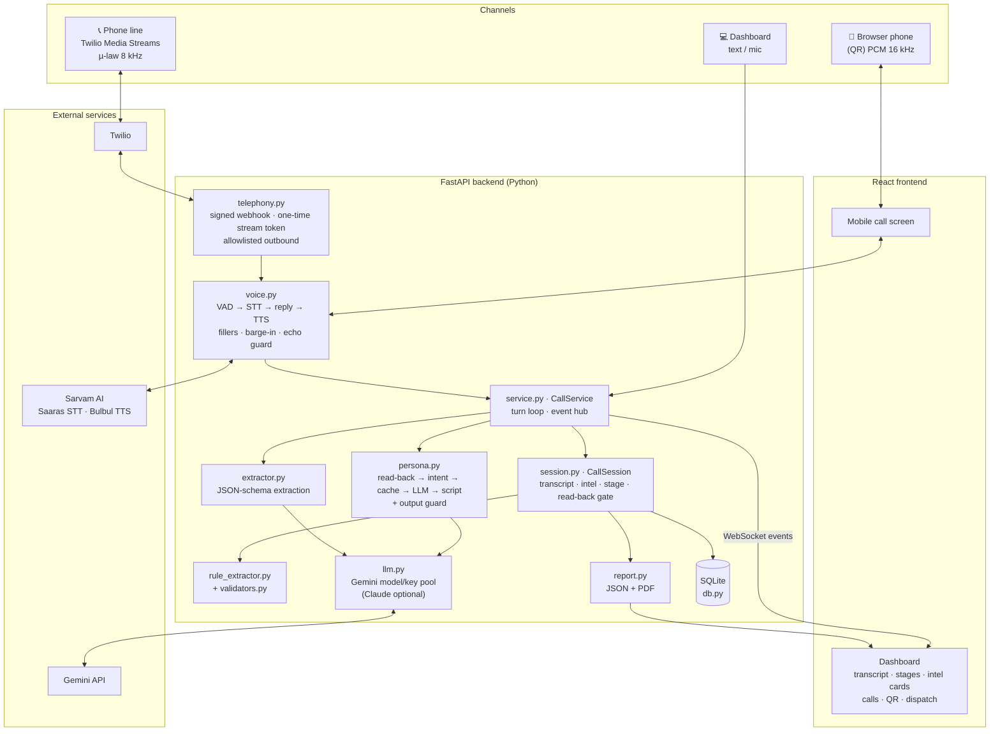
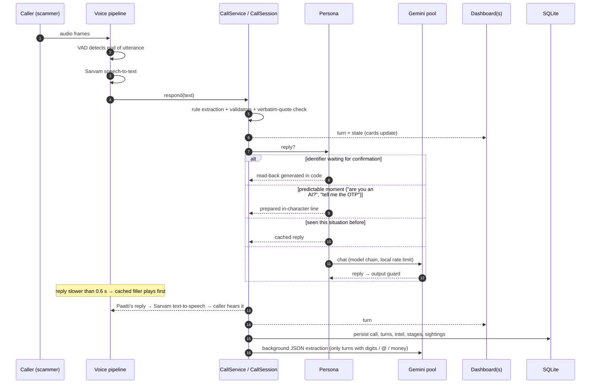
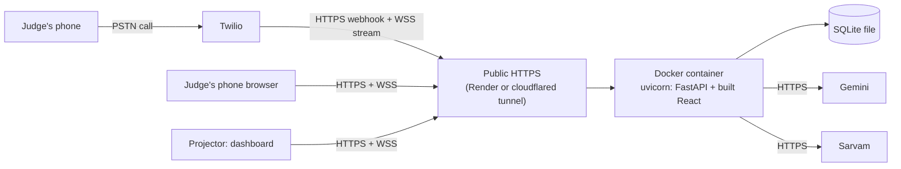

# System architecture

For the detailed walkthrough of every component, see [STUDY.md](STUDY.md). Database and ER diagram: [DATABASE.md](DATABASE.md).

## Components

## Data flow of one caller turn

## Deployment

## Key design decisions
| Decision | Why |
|---|---|
| Read-backs generated in code, not by the LLM | The digits repeated must equal the digits captured; this is what makes the confirmation evidence. |
| Two extractors behind one validation gate | Regex is instant and free; the LLM adds recall; validators + verbatim quotes stop hallucinations either way. |
| Cheapest-first reply ladder | Read-back → intent → cache → LLM → script keeps API usage and latency low and guarantees an answer. |
| Model/key rotation with local rate limiting | Free-tier Gemini limits and overloads (we saw 404 and 503 in testing) must never stall a live call. |
| In-memory session + write-through SQLite | Live calls stay fast; history and the cross-call mule registry survive restarts. |
| One event hub for all screens | The projector can follow a phone call live; any number of watchers. |
| Phone calls are watch-only from dashboards | Nobody with a session ID can inject lines into, or end, a live phone call. |
