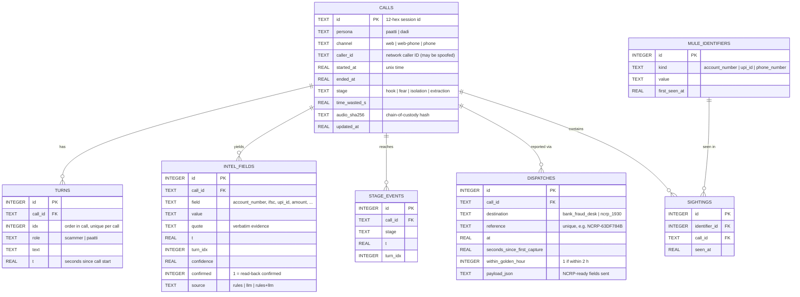

# Database

Paatti stores every call in **SQLite** (Python's built-in `sqlite3`, no server to run). The live call runs in memory for speed (`CallSession`); every change is written through to the database by `CallService.persist` (`backend/paatti/db.py`). The database file defaults to `backend/data/paatti.db` (set `PAATTI_DB` to change it).

**Why a database:** calls survive a restart, the dashboard can show call history, and, most importantly, the **mule registry** links the same account, UPI ID or phone number across different calls. That is the "repeat match" that raises confidence in an identifier.

## ER diagram



## Tables

| Table | One row per | Key constraints |
|---|---|---|
| `calls` | call (session) | `channel` and `stage` are CHECK-constrained enums |
| `turns` | spoken line | `UNIQUE(call_id, idx)`: a turn is written once |
| `intel_fields` | captured fact | `UNIQUE(call_id, field, value)`; rewritten on each save so it mirrors the live state |
| `stage_events` | stage reached | `UNIQUE(call_id, stage)`: stages only move forward |
| `mule_identifiers` | distinct account / UPI / phone | `UNIQUE(kind, value)` |
| `sightings` | identifier seen in a call | `UNIQUE(identifier_id, call_id)`; this many-to-many link is the repeat match |
| `dispatches` | mock hand-off of a report | `reference` unique; `destination` CHECK-constrained |

All child tables use `ON DELETE CASCADE` foreign keys to `calls`, and there are indexes on the foreign-key columns.

## Relationships in plain words
- A **call** has many **turns**, many **intel fields**, up to four **stage events** and any number of **dispatches**.
- **Mule identifiers ↔ calls** is many-to-many through **sightings**: one account can appear in many calls, and one call can mention several identifiers. When a new call mentions an identifier with earlier sightings, the session's `repeat_sessions` lists those calls and confidence goes up (+0.05 per earlier sighting, up to two).

## Example queries

```sql
-- Mule accounts seen in more than one call (strongest leads)
SELECT m.kind, m.value, COUNT(*) AS calls
FROM mule_identifiers m JOIN sightings s ON s.identifier_id = m.id
GROUP BY m.id HAVING calls > 1 ORDER BY calls DESC;

-- Calls where an account was read-back confirmed, with time to capture
SELECT c.id, c.channel, i.value, i.t AS seconds_into_call
FROM calls c JOIN intel_fields i ON i.call_id = c.id
WHERE i.field = 'account_number' AND i.confirmed = 1;

-- Dispatches made inside the golden hour
SELECT reference, destination, seconds_since_first_capture FROM dispatches WHERE within_golden_hour = 1;
```

API views of this data: `GET /api/history` (recent calls, mule registry, row counts).
